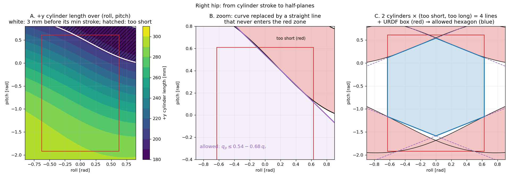

# Limites couplées hanche / cheville (vérins) — en une page

**Le problème.** Sur RHPS1, le roulis et le tangage de chaque hanche et de chaque cheville sont actionnés par **deux vérins**. Les limites URDF sont un rectangle (roulis entre ±36°, tangage entre deux bornes), mais dans les coins de ce rectangle un vérin est déjà en fin de course : la position est physiquement impossible et le moteur force contre la butée. Les coins impossibles font 19 % du rectangle pour la hanche, 15 % pour la cheville.

**Pourquoi les limites dépendent l'une de l'autre ?** Quand la hanche fléchit (tangage), les deux vérins s'allongent ensemble ; quand elle penche (roulis), l'un s'allonge et l'autre raccourcit. Un grand tangage *et* un grand roulis demandent donc à l'un des deux vérins d'être trop court ou trop long.

**Comment trouve-t-on la zone autorisée ? (figure A)** Pour chaque couple (roulis, tangage), on calcule la longueur de chaque vérin avec la géométrie exacte du robot (le même calcul que le logiciel du robot, `AngleToCylinder.cpp`). Le vérin doit rester entre sa longueur mini et maxi, moins une marge de **3 mm**. La frontière est une **courbe**.

**Pourquoi la remplacer par une droite ? (figure B)** Le QP ne sait gérer que des contraintes **linéaires**, c'est-à-dire des droites. On remplace donc chaque courbe par une droite placée pour **ne jamais entrer dans la zone interdite**, en restant le plus près possible de la courbe. Exemple pour la hanche droite :

$$\text{tangage} \le 0{,}54 - 0{,}68 \times \text{roulis}$$

C'est une droite de lycée $y \le a\,x + b$. Le côté autorisé (ici en dessous) s'appelle un *demi-plan*.

**Combien de droites ? (figure C)** 2 vérins × (trop court, trop long) = **4 droites par articulation**, donc 16 en tout (2 hanches, 2 chevilles). Avec le rectangle URDF, il reste un **hexagone** : c'est la zone autorisée. Elle garde 97 % de la zone réellement utilisable pour la hanche, 99,6 % pour la cheville.

**Que veut dire $(q - p_1) \times (p_2 - p_1) \le 0$ dans la config ?** C'est la façon de mc_rtc d'écrire une droite : $p_1$ et $p_2$ sont deux points de la droite, $q$ = (roulis, tangage). Le produit vectoriel en 2D est un simple nombre, $v \times u = v_x u_y - v_y u_x$ ; son signe dit de quel côté de la droite est $q$. En marchant de $p_1$ vers $p_2$ (roulis en abscisse, tangage en ordonnée), la zone autorisée est à gauche. On note

$$g(q) = \text{distance (signée) de } q \text{ à la droite}$$

- $g(q) < 0$ : on est du bon côté ;
- $g(q) > 0$ : on est sorti, de $g(q)$ radians.

**Comment le QP la fait respecter ?** Le QP choisit des **accélérations**, pas des positions. Il prédit où l'articulation sera au pas suivant ($q_{\text{suivant}} = q + \Delta t\,\dot q + \tfrac{\Delta t^2}{2}\,\ddot q$, la formule de la physique de lycée) et interdit les accélérations qui feraient sortir. Pour ne pas piler au dernier moment, il **freine progressivement** : à moins de $d_i \approx 6$–$7°$ de la droite, la vitesse d'approche est limitée, proportionnellement à la distance restante, et il s'arrête à $d_s \approx 0{,}6$–$0{,}7°$ de la droite. C'est exactement le même freinage que pour les limites articulaires normales (mêmes réglages), et il marche avec les deux solveurs de mc_rtc (TVM et Tasks).

**Et la cible envoyée par la politique ?** Si la politique demande une position hors de l'hexagone, on la ramène sur la droite par le plus court chemin (perpendiculairement) :

$$q \leftarrow q - g(q)\,\vec n \qquad (\vec n = \text{vecteur unitaire perpendiculaire à la droite, vers l'extérieur})$$

Ça couvre aussi le mode sans QP. Le QP reste un filet de sécurité.

**Ça change la marche ?** Non : en marche normale (mc_mujoco, slot 21), aucune correction, distances identiques (+1,65 m en 13 s). Les logs du robot réel restent à ≥ 19 mm des butées. Les limites servent pour les grands mouvements (escaliers, chutes). Test avec une limite artificielle sur la cheville : la consigne s'arrête à 0,6° avant la droite, avec ou sans projection.

**Où est le code ?**
- `etc/NewRLQPController.in.yaml`, section `cylinder_limits` : les 16 droites (`project_targets: false` = QP seul).
- `src/CylinderLimitsConstraint.h` : la contrainte QP avec le freinage (TVM et Tasks).
- `NewRLQPController::projectCylinderLimits()` : la projection de la cible.
- Logs : `NewRLQPController_cyl_proj_count` (droites qui ont corrigé la cible ce pas), `_cyl_proj_max` (plus grande correction, rad).
- `scripts/cylinder_limits.py --margin-mm 3` : recalcule les droites et la figure (changer la marge, vérifier la géométrie).
- mjlab, `RHPS1_CYL_LIMITS=1` : les mêmes 16 droites en butées physiques (tendons MuJoCo) et la même projection des cibles (`asset_zoo/robots/RHPS1/rhps1_cylinders.py`).
